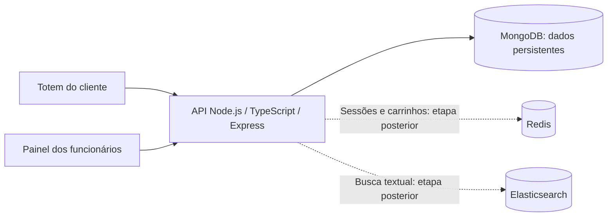
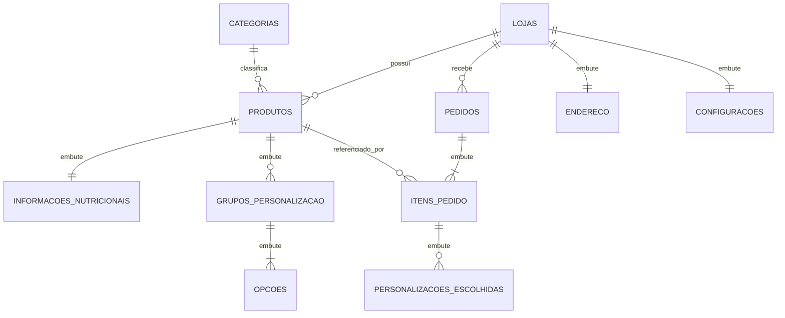

# Checkpoint 1 — Sistema de Autoatendimento por Totens

**Disciplina:** Banco de Dados NoSQL — TSI34E-TSI4  
**Instituição:** UTFPR — Campus Guarapuava  
**Professor:** Marcelo Vichar  
**Integrantes:** Eduardo Padilha do Nascimento, Emilly Zatti e Marcos Vinicius Olenka de Macedo  
**Repositório:** https://github.com/eduardo-padilha-dev/api-totem-ordering-system

## Seção 1: Tema e Escopo do Sistema

O projeto consiste em um sistema de autoatendimento presencial para restaurantes e lanchonetes que utilizam totens para registrar pedidos. O problema abordado é a concentração do atendimento no balcão, que pode gerar filas e erros na comunicação de escolhas e adicionais. Pelo totem, o cliente poderá consultar o cardápio da loja, visualizar ingredientes e informações nutricionais, personalizar produtos e confirmar seu pedido para retirada no próprio estabelecimento.

Os principais usuários são os clientes que utilizam os totens e os funcionários responsáveis pelo cardápio e pelo acompanhamento dos pedidos. O sistema deverá apoiar a organização da fila de preparo e disponibilizar indicadores de vendas por loja e período. O recorte do projeto é o atendimento presencial: a identificação do totem, as personalizações de cada item e o acompanhamento do preparo caracterizam seu fluxo. Entrega em domicílio, gestão de entregadores, integração com pagamentos reais e cadastro obrigatório de clientes ficam fora do escopo inicial.

O MongoDB será a fonte da verdade para lojas, categorias, produtos e pedidos. O modelo documental permite representar produtos com ingredientes e opções diferentes, além de guardar os itens de um pedido junto de seus preços e personalizações históricos. Na arquitetura semestral, o Redis será destinado às sessões e aos carrinhos temporários, com expiração, e o Elasticsearch à busca textual de produtos. Neste checkpoint, as cinco consultas serão executadas diretamente no MongoDB pelo driver oficial na API Node.js/TypeScript com Express.

### Arquitetura inicial



MongoDB concentra os dados persistentes do negócio; o conteúdo transitório de um carrinho ainda não confirmado existe na sessão. Na evolução prevista na atividade anterior, a API sincronizará alterações de produtos com o índice de busca e invalidará o cache correspondente. Leituras de dados cacheáveis poderão usar cache-aside com TTL. Essa sincronização entre bancos não é uma transação única: falhas deverão permitir nova tentativa ou reconstrução do índice a partir do MongoDB.

## Seção 2: Entidades e Coleções

Serão utilizadas quatro coleções: `lojas`, `categorias`, `produtos` e `pedidos`.

### Convenções de dados

- Identificadores e referências serão BSON **ObjectId**. O povoamento omite `_id` na inserção e usa `insertedIds` para relacionar os documentos. Os exemplos usam IDs ilustrativos; consulte os valores reais no banco. As referências usam os IDs retornados pelas inserções, sem rótulos auxiliares.
- Datas serão BSON **Date**, armazenadas em UTC. Os exemplos usam Extended JSON (`{"$date": "..."}`); no script de inicialização, os valores deverão ser convertidos para `Date`, e não inseridos como objetos literais com chave `$date`.
- Valores monetários serão BSON **Int32**, expressos em centavos. O campo `preco: 32.90` do protótipo passa a ser `preco_centavos: 3290`. Isso evita cálculos monetários em ponto flutuante. A interface formatará os valores em reais.
- Quantidades, estoque, posições e limites serão **Int32**; medidas nutricionais serão **Double**. O script deverá criar os tipos BSON indicados explicitamente quando necessário.
- Todos os campos listados são obrigatórios. Arrays podem ser vazios quando não houver elementos aplicáveis. As regras abaixo deverão ser verificadas pela aplicação e, quando possível, por validadores de coleção.

### 2.1. Coleção `lojas`

Representa as unidades físicas atendidas pelo sistema.

| Campo | Tipo BSON | Descrição / regra |
|---|---|---|
| `_id` | ObjectId | Identificador da loja |
| `nome` | String | Nome de exibição |
| `ativa` | Boolean | Indica se a loja aceita atendimento |
| `endereco` | Subdocumento | Endereço da unidade |
| `endereco.logradouro` | String | Rua ou avenida |
| `endereco.numero` | String | Número, permitindo valores como `100A` |
| `endereco.bairro` | String | Bairro |
| `endereco.cidade` | String | Cidade |
| `endereco.uf` | String | Sigla do estado |
| `endereco.cep` | String | CEP formatado |
| `configuracoes` | Subdocumento | Configurações do atendimento |
| `configuracoes.tempo_estimado_minutos` | Int32 | Estimativa não negativa de preparo |
| `configuracoes.aceita_personalizacao` | Boolean | Habilita personalização no totem |
| `data_criacao` | Date | Data de cadastro |

### 2.2. Coleção `categorias`

Representa uma classificação compartilhada entre lojas, como lanches, bebidas e acompanhamentos. Cada produto pertence a uma única categoria; uma categoria pode ser utilizada por produtos de várias lojas.

| Campo | Tipo BSON | Descrição / regra |
|---|---|---|
| `_id` | ObjectId | Identificador da categoria |
| `nome` | String | Nome único da categoria |
| `descricao` | String | Descrição curta |
| `ordem_exibicao` | Int32 | Posição não negativa no cardápio |
| `ativa` | Boolean | Categoria habilitada para exibição |
| `data_criacao` | Date | Data de cadastro |

### 2.3. Coleção `produtos`

Representa um item do cardápio de uma loja. Um produto vendido em duas lojas será representado por dois documentos, permitindo preço, estoque e disponibilidade independentes.

| Campo | Tipo BSON | Descrição / regra |
|---|---|---|
| `_id` | ObjectId | Identificador do produto |
| `loja_id` | ObjectId | Referência a `lojas._id` |
| `categoria_id` | ObjectId | Referência a `categorias._id` |
| `nome` | String | Nome do produto |
| `descricao` | String | Descrição para o cliente |
| `preco_centavos` | Int32 | Preço base não negativo |
| `disponivel` | Boolean | Disponibilidade definida pela loja |
| `destaque` | Boolean | Indica destaque no cardápio |
| `estoque` | Int32 | Quantidade não negativa de unidades vendáveis |
| `informacoes_nutricionais` | Subdocumento | Informações por unidade |
| `informacoes_nutricionais.calorias` | Double | Valor energético em kcal |
| `informacoes_nutricionais.proteinas` | Double | Proteínas em gramas |
| `informacoes_nutricionais.carboidratos` | Double | Carboidratos em gramas |
| `informacoes_nutricionais.gorduras` | Double | Gorduras em gramas |
| `informacoes_nutricionais.contem_gluten` | Boolean | Presença de glúten |
| `ingredientes` | Array de String | Ingredientes do produto |
| `tags` | Array de String | Marcadores do catálogo |
| `grupos_personalizacao` | Array de Subdocumento | Grupos de opções vinculados ao produto |
| `grupos_personalizacao[].nome` | String | Nome do grupo, único no produto |
| `grupos_personalizacao[].minimo` | Int32 | Mínimo de opções distintas selecionadas |
| `grupos_personalizacao[].maximo` | Int32 | Máximo de opções distintas selecionadas |
| `grupos_personalizacao[].opcoes` | Array de Subdocumento | Opções permitidas |
| `grupos_personalizacao[].opcoes[].nome` | String | Nome único dentro do grupo |
| `grupos_personalizacao[].opcoes[].preco_adicional_centavos` | Int32 | Acréscimo não negativo por unidade |
| `data_criacao` | Date | Data de cadastro |

Cada opção pode ser selecionada uma vez por unidade. Deve valer `0 <= minimo <= maximo <= quantidade de opcoes`. Como limites iniciais da aplicação, um produto terá até 30 ingredientes, 20 tags e 10 grupos de personalização, com até 20 opções por grupo. Textos descritivos terão no máximo 1.000 caracteres e os demais textos de produtos, 200. Esses limites mantêm o crescimento dos dados embutidos controlado.

### 2.4. Coleção `pedidos`

Representa um pedido confirmado no totem. O carrinho em andamento não integra esta coleção. A identificação do totem é um código operacional local à loja; não haverá coleção própria de equipamentos neste recorte.

| Campo | Tipo BSON | Descrição / regra |
|---|---|---|
| `_id` | ObjectId | Identificador do pedido |
| `loja_id` | ObjectId | Referência a `lojas._id` |
| `totem_codigo` | String | Código do totem dentro da loja |
| `status` | String | `recebido`, `em_preparo`, `pronto`, `concluido` ou `cancelado` |
| `itens` | Array de Subdocumento | De 1 a 50 linhas de itens |
| `itens[].produto_id` | ObjectId | Referência a `produtos._id` |
| `itens[].nome_produto` | String | Nome do produto no momento da compra |
| `itens[].quantidade` | Int32 | Quantidade de 1 a 99 unidades |
| `itens[].preco_base_centavos` | Int32 | Preço base unitário histórico |
| `itens[].personalizacoes` | Array de Subdocumento | Opções selecionadas, por unidade |
| `itens[].personalizacoes[].grupo` | String | Nome histórico do grupo |
| `itens[].personalizacoes[].opcao` | String | Nome histórico da opção |
| `itens[].personalizacoes[].preco_adicional_centavos` | Int32 | Acréscimo unitário histórico |
| `itens[].preco_unitario_centavos` | Int32 | Base mais adicionais selecionados |
| `itens[].subtotal_centavos` | Int32 | Quantidade multiplicada pelo preço unitário |
| `itens[].observacao` | String | Observação de preparo, até 300 caracteres; aceita texto vazio |
| `total_centavos` | Int32 | Soma dos subtotais dos itens |
| `data_criacao` | Date | Momento da confirmação do pedido |
| `data_atualizacao` | Date | Momento da última alteração de status |

Itens com personalizações diferentes ocupam linhas distintas. Valores e totais serão calculados pela API a partir do catálogo, sem confiar em preços enviados pelo cliente. Totais deverão caber no intervalo positivo de Int32. O modelo não inclui descontos, taxas ou pagamentos nesta etapa.

O fluxo previsto é `recebido → em_preparo → pronto → concluido`; cancelamentos serão permitidos a partir de `recebido` ou `em_preparo`. Alterações de status deverão filtrar também o status anterior esperado para impedir transições concorrentes indevidas. O conteúdo comercial dos itens permanece imutável após a confirmação.

### Integridade e índices previstos

O MongoDB não cria chaves estrangeiras automaticamente. A aplicação e o script de povoamento deverão garantir que todas as referências existam e que cada produto de um pedido pertença à mesma loja do pedido. Lojas e categorias inativas e produtos indisponíveis ou sem estoque não poderão gerar novas vendas. Documentos referenciados pelo histórico serão mantidos, utilizando desativação em vez de exclusão física.

| Coleção | Índice proposto | Finalidade |
|---|---|---|
| Todas | `{ _id: 1 }`, único e padrão | Identificação e consultas por ID |
| `categorias` | `{ nome: 1 }`, único | Evitar nomes idênticos duplicados |
| `produtos` | `{ loja_id: 1, disponivel: 1, nome: 1, _id: 1 }` | Cardápio da loja com ordenação estável |
| `produtos` | `{ loja_id: 1, categoria_id: 1, disponivel: 1, nome: 1, _id: 1 }` | Cardápio filtrado por categoria |
| `pedidos` | `{ loja_id: 1, status: 1, data_criacao: 1, _id: 1 }` | Fila filtrada por status e relatórios por loja/período |

Os índices são propostos a partir dos filtros e ordenações da Seção 6. A condição de estoque e os agrupamentos ainda exigirão processamento dos documentos selecionados. Cada índice aumenta o custo de escrita e armazenamento; sua utilização deverá ser verificada com `explain` durante a implementação.

## Seção 3: Justificativa Técnica — Embedding vs. Referencing

| Relacionamento / informação | Decisão | Padrão de acesso, crescimento e trade-off |
|---|---|---|
| Loja → endereço e configurações | Embedding | São lidos junto da loja, têm tamanho pequeno e não possuem ciclo de vida independente. Podem ser atualizados atomicamente no mesmo documento. |
| Produto → informações nutricionais | Embedding | A tela de detalhe consulta as informações com o produto. O conjunto de campos é limitado; separar exigiria uma consulta adicional sem benefício neste escopo. |
| Produto → ingredientes, tags e personalizações | Embedding | A montagem do item usa esses dados em conjunto. Arrays têm limites definidos; uma alteração no produto atualiza suas opções no mesmo documento. Compartilhar opções entre produtos exigiria outra modelagem. |
| Produto → loja | Referencing por `loja_id` | Uma loja pode acumular muitos produtos. Embutir o catálogo na loja criaria crescimento contínuo e concentraria atualizações de estoque no mesmo documento. O custo é validar a referência e consultar a loja quando necessário. |
| Produto → categoria | Referencing por `categoria_id` | A classificação é compartilhada e pode ser renomeada sem reescrever todos os produtos. Para exibir seu nome junto do produto, será necessária consulta adicional ou `$lookup`. |
| Pedido → loja | Referencing por `loja_id` | O histórico de pedidos cresce continuamente. Mantê-lo fora da loja evita arrays sem limite e permite consultar pedidos por loja, status e período. |
| Pedido → itens e personalizações escolhidas | Embedding | Fila e detalhe do pedido precisam do conjunto completo. O limite de 50 linhas controla o crescimento. A gravação do pedido é atômica em um documento e preserva os valores da compra. |
| Item do pedido → produto | Referencing + cópia histórica | `produto_id` permite relacionar vendas ao produto. Nome, preços e opções são copiados intencionalmente para que mudanças no catálogo não alterem pedidos anteriores. A duplicação aumenta o armazenamento, mas evita reconstruir o histórico com valores atuais. |

O limite de 16 MB por documento impede tratar arrays como estruturas de crescimento ilimitado. Por isso, produtos e pedidos têm limites de conteúdo, enquanto o histórico de pedidos permanece em coleção própria. A atomicidade de um pedido não torna atômica uma operação que também altere estoque em vários produtos; esse fluxo exigirá controle específico de concorrência na implementação de criação de pedidos, fora das cinco consultas deste checkpoint.

## Seção 4: Relacionamentos e Cardinalidade

| Origem | Destino | Cardinalidade | Chave / representação |
|---|---|---|---|
| Loja | Produto | 1:N | `produtos.loja_id → lojas._id`; cada produto pertence a uma loja |
| Categoria | Produto | 1:N | `produtos.categoria_id → categorias._id`; cada produto pertence a uma categoria |
| Loja | Pedido | 1:N | `pedidos.loja_id → lojas._id`; cada pedido pertence a uma loja |
| Loja | Endereço | 1:1 | `lojas.endereco`, embutido |
| Loja | Configurações | 1:1 | `lojas.configuracoes`, embutido |
| Produto | Informações nutricionais | 1:1 | `produtos.informacoes_nutricionais`, embutido |
| Produto | Grupo de personalização | 1:N limitado | `produtos.grupos_personalizacao`, de 0 a 10 grupos embutidos |
| Grupo de personalização | Opção | 1:N limitado | `grupos_personalizacao[].opcoes`, de 1 a 20 opções por grupo |
| Pedido | Item do pedido | 1:N limitado | `pedidos.itens`, de 1 a 50 linhas embutidas |
| Item do pedido | Personalização escolhida | 1:N limitado | `itens[].personalizacoes`; limitado às opções do produto na compra |
| Produto | Item do pedido | 1:N | `pedidos.itens[].produto_id → produtos._id` |
| Pedido | Produto | N:N conceitual | Resolvido pelos itens embutidos: um pedido tem vários produtos e um produto participa de vários pedidos |

Lojas e categorias podem existir sem produtos, e lojas e produtos podem existir sem pedidos. A relação entre lojas e categorias é N:N derivada dos produtos, sem lista própria de referências. Não serão mantidos arrays inversos de produtos ou pedidos dentro de lojas e categorias.



Somente `LOJAS`, `CATEGORIAS`, `PRODUTOS` e `PEDIDOS` correspondem a coleções. As demais entidades do diagrama representam subdocumentos.

## Seção 5: Exemplos de Documentos JSON

Os exemplos a seguir são JSON sintaticamente válido, com datas representadas em Extended JSON. Os IDs usam Extended JSON com `$oid`. Os números devem receber os tipos BSON definidos na Seção 2 ao serem inseridos pelo script.

### 5.1. Loja

```json
{
  "_id": { "$oid": "650000000000000000000001" },
  "nome": "Estação do Lanche — Centro",
  "ativa": true,
  "endereco": {
    "logradouro": "Rua XV de Novembro",
    "numero": "880",
    "bairro": "Centro",
    "cidade": "Guarapuava",
    "uf": "PR",
    "cep": "85010-000"
  },
  "configuracoes": {
    "tempo_estimado_minutos": 15,
    "aceita_personalizacao": true
  },
  "data_criacao": { "$date": "2026-09-08T12:00:00Z" }
}
```

### 5.2. Categoria

```json
{
  "_id": { "$oid": "650000000000000000000002" },
  "nome": "Lanches",
  "descricao": "Hambúrgueres e sanduíches preparados na loja",
  "ordem_exibicao": 1,
  "ativa": true,
  "data_criacao": { "$date": "2026-09-08T12:10:00Z" }
}
```

### 5.3. Produto

```json
{
  "_id": { "$oid": "650000000000000000000003" },
  "loja_id": { "$oid": "650000000000000000000001" },
  "categoria_id": { "$oid": "650000000000000000000002" },
  "nome": "Big Burger Bacon",
  "descricao": "Hambúrguer artesanal com queijo, bacon e molho especial",
  "preco_centavos": 3290,
  "disponivel": true,
  "destaque": false,
  "estoque": 150,
  "informacoes_nutricionais": {
    "calorias": 720.0,
    "proteinas": 32.5,
    "carboidratos": 48.0,
    "gorduras": 39.2,
    "contem_gluten": true
  },
  "ingredientes": ["Pão brioche", "Hambúrguer 180g", "Queijo", "Bacon", "Molho especial"],
  "tags": ["hamburguer", "bacon", "mais_vendidos"],
  "grupos_personalizacao": [
    {
      "nome": "Adicionais",
      "minimo": 0,
      "maximo": 2,
      "opcoes": [
        { "nome": "Bacon extra", "preco_adicional_centavos": 450 },
        { "nome": "Queijo extra", "preco_adicional_centavos": 300 }
      ]
    }
  ],
  "data_criacao": { "$date": "2026-09-08T13:00:00Z" }
}
```

O máximo do grupo foi ajustado para duas escolhas, pois o exemplo contém duas opções distintas. As informações nutricionais correspondem ao produto base.

### 5.4. Pedido

```json
{
  "_id": { "$oid": "650000000000000000000004" },
  "loja_id": { "$oid": "650000000000000000000001" },
  "totem_codigo": "TOTEM-01",
  "status": "concluido",
  "itens": [
    {
      "produto_id": { "$oid": "650000000000000000000003" },
      "nome_produto": "Big Burger Bacon",
      "quantidade": 2,
      "preco_base_centavos": 3290,
      "personalizacoes": [
        { "grupo": "Adicionais", "opcao": "Bacon extra", "preco_adicional_centavos": 450 }
      ],
      "preco_unitario_centavos": 3740,
      "subtotal_centavos": 7480,
      "observacao": "Sem molho especial"
    }
  ],
  "total_centavos": 7480,
  "data_criacao": { "$date": "2026-09-09T15:30:00Z" },
  "data_atualizacao": { "$date": "2026-09-09T15:48:00Z" }
}
```

Neste pedido, cada unidade custa R$ 32,90 + R$ 4,50 = R$ 37,40. As duas unidades totalizam R$ 74,80. O nome e os valores registrados permanecem iguais mesmo que o produto seja renomeado ou seu preço seja alterado.

### Povoamento previsto em `init/mongo-init.js`

O script deverá criar as quatro coleções, os índices e **30 documentos realistas**, distribuídos da seguinte maneira:

| Coleção | Quantidade |
|---|---:|
| `lojas` | 2 |
| `categorias` | 4 |
| `produtos` | 12 |
| `pedidos` | 12 |
| **Total** | **30** |

O conjunto deverá conter produtos das duas lojas, opções de personalização, pelo menos um produto indisponível e um sem estoque. Os pedidos deverão abranger todos os cinco status, mais de um dia, itens repetidos em pedidos diferentes e personalizações com acréscimo de preço. Deverá haver pedidos concluídos nas duas lojas para validar o isolamento dos relatórios.

A inserção deverá seguir a ordem `lojas → categorias → produtos → pedidos`, utilizando os IDs retornados por `insertMany` e validando referências e totais. Os quatro documentos exemplificados acima deverão fazer parte desse conjunto. Os documentos embutidos não serão contados como documentos adicionais para atingir o mínimo de 20 exigido.

## Seção 6: Relatórios e Indicadores de Negócio

As cinco consultas abaixo serão implementadas em controllers e rotas Express, utilizando `getCollection` e o driver oficial do MongoDB. Para esta avaliação, as consultas não dependerão de cache Redis ou busca Elasticsearch.

### Regras comuns dos endpoints

- `store_id` é obrigatório nas cinco consultas e identifica o contexto do totem ou painel. IDs chegam como texto hexadecimal de 24 caracteres e são validados e convertidos para ObjectId antes da consulta.
- Parâmetros inválidos retornam HTTP `400`. Loja inexistente ou inativa e produto não acessível retornam `404`. Consultas sem resultados retornam `200` com lista vazia ou indicadores zerados.
- Listagens usam `page` (padrão 1) e `limit` (padrão 20, máximo 100), ambos inteiros positivos. Retornam `{ data, page, limit }`.
- Os relatórios recebem `start` e `end` em ISO 8601 com fuso explícito. O período usa `created_at >= start` e `created_at < end`, com `start < end`.
- Os relatórios consideram apenas pedidos com status atual `completed`, usando `created_at` como referência.
- O banco é a fonte dos preços e totais; respostas mantêm valores monetários em centavos. Erros internos retornam `500` com mensagem genérica.

### 6.1. Cardápio disponível no totem

**Endpoint:** `GET /api/products?store_id=650000000000000000000001&category_id=650000000000000000000002&page=1&limit=20`

**Objetivo:** alimentar a tela inicial com produtos que podem ser selecionados na loja.

**Consulta:** validar a loja ativa; filtrar `products` por `store_id`, `available: true` e `stock > 0`. Aplicar `category_id` quando informado e excluir produtos de categorias inativas por consulta às categorias. Ordenar por `name` e `_id`, ambos crescentes, antes da paginação.

**Projeção:** `_id`, `name`, `description`, `price_cents`, `category_id` e `featured`. Ingredientes e personalizações ficam para a tela de detalhe, reduzindo o volume transferido.

**Operações previstas:** `find`/`aggregate`, filtros combinados, projeção, ordenação, `skip` e `limit`.

### 6.2. Detalhe e personalização do produto

**Endpoint:** `GET /api/products/650000000000000000000003?store_id=650000000000000000000001`

**Objetivo:** apresentar as informações necessárias para personalizar um item antes de adicioná-lo ao carrinho.

**Consulta:** buscar por `_id` e `store_id`, verificando loja e categoria ativas, disponibilidade e estoque positivo. Isso impede que um totem consulte como vendável um produto de outra loja.

**Retorno:** objeto `{ data }` com identificação, nome, descrição, preço, ingredientes, tags, informações nutricionais e grupos de personalização. O campo de estoque interno e a data de cadastro não são exibidos.

**Operações previstas:** `findOne` com projeção e consultas de validação de loja/categoria. A venda deverá revalidar preço e disponibilidade no momento da confirmação, pois a consulta não reserva estoque.

### 6.3. Fila de preparo da loja

**Endpoint:** `GET /api/orders?store_id=650000000000000000000001&status=received&page=1&limit=20`

**Objetivo:** alimentar o painel dos funcionários com pedidos a preparar ou entregar.

**Consulta:** filtrar por loja e por um status operacional (`received`, `preparing` ou `ready`). Quando `status` não for informado, selecionar esses três valores com `$in`. Ordenar por `created_at` crescente e `_id` crescente para priorizar pedidos antigos e manter estabilidade.

**Retorno:** identificação do pedido, `terminal_code`, `status`, `created_at` e itens com quantidades, nomes históricos, personalizações e observações. Os preços são omitidos da projeção da fila.

**Operações previstas:** `find`, `$in`, projeção, `sort`, `skip` e `limit`. Esta consulta lista pedidos; não altera status.

### 6.4. Resumo de vendas por período

**Endpoint:** `GET /api/reports/sales?store_id=650000000000000000000001&start=2026-09-09T00:00:00Z&end=2026-09-10T00:00:00Z`

**Objetivo:** exibir quantidade de pedidos concluídos, valor vendido e ticket médio no painel da loja.

**Consulta:** filtrar por loja, status `completed` e intervalo de `created_at`; agrupar os pedidos selecionados.

**Indicadores:**

- `order_count`: contagem dos pedidos selecionados.
- `revenue_cents`: soma de `total_cents`.
- `average_ticket_cents`: faturamento dividido pela quantidade de pedidos, arredondado ao centavo mais próximo.

**Operações realizadas:** pipeline com `$match` e `$group` usando `$sum`. Quando não houver pedidos, a API retorna os três indicadores iguais a zero, evitando divisão por zero.

O faturamento corresponde ao valor dos pedidos concluídos, sem taxas, descontos ou comprovação financeira externa. Para o pedido de exemplo isolado, o resultado seria 1 pedido, 7.480 centavos de faturamento e 7.480 centavos de ticket médio.

### 6.5. Produtos mais vendidos

**Endpoint:** `GET /api/reports/top-products?store_id=650000000000000000000001&start=2026-09-09T00:00:00Z&end=2026-09-10T00:00:00Z&limit=10`

**Objetivo:** identificar os produtos com maior volume de unidades vendidas no período.

**Consulta:** selecionar pedidos `completed` da loja no intervalo, ordenar por `created_at` e `_id` decrescentes, expandir `items` e agrupar por `items.product_id`. Somar quantidades e subtotais históricos. O nome de exibição será o nome histórico da venda mais recente no período, selecionado com `$first` após a ordenação; uma mudança de nome não divide o mesmo produto em grupos diferentes.

**Retorno:** `{ data }` com `product_id`, `product_name`, `quantity_sold` e `revenue_cents`, ordenados por quantidade decrescente e `product_id` crescente em caso de empate. `limit` tem padrão 10 e máximo 100; esta consulta não utiliza `page`.

**Operações previstas:** `$match`, `$sort`, `$unwind`, `$group`, `$project`, `$sort` e `$limit`. A receita inclui os adicionais vendidos e não usa o preço atual do catálogo. Para o pedido de exemplo isolado, `650000000000000000000003` teria 2 unidades e receita de 7.480 centavos.

### Organização prevista na API

| Arquivo | Responsabilidade |
|---|---|
| `app/src/controllers/products.controller.ts` | Consultas 1 e 2 |
| `app/src/controllers/orders.controller.ts` | Consulta 3 |
| `app/src/controllers/reports.controller.ts` | Consultas 4 e 5 |
| `app/src/routes/products.routes.ts` | Rotas de listagem e detalhe de produtos |
| `app/src/routes/orders.routes.ts` | Rota da fila de pedidos |
| `app/src/routes/reports.routes.ts` | Rotas dos indicadores de vendas |
| `app/src/routes/index.ts` | Registro dos três conjuntos de rotas sob `/api` |

## Preparação e verificação da entrega

A documentação cobre a proposta de modelagem. Para concluir o checkpoint executável, ainda será necessário:

- [x] Adaptar `init/mongo-init.js` ao banco do projeto e inserir os 30 documentos definidos, com tipos BSON corretos, índices e referências válidas.
- [x] Alinhar o nome do banco entre o script, `MONGO_DB_NAME` no Docker Compose e o fallback de `app/src/database/mongo.ts` (`totem_ordering_system`).
- [x] Implementar e registrar os cinco endpoints documentados.
- [ ] Validar a inicialização em um ambiente com volume MongoDB novo, pois o script de entrada não é reaplicado automaticamente em um volume já inicializado. Preservar dados existentes durante esse teste.
- [x] Testar filtros por loja, categorias inativas, produtos indisponíveis, paginação, ausência de resultados e parâmetros inválidos.
- [x] Conferir os relatórios manualmente com os pedidos do povoamento, incluindo exclusão de cancelados e limites de datas.
- [ ] Garantir código e documentação funcionais na branch `main`, que será avaliada pelo professor.
- [ ] Informar no formulário do Moodle o link do repositório e os integrantes, conforme a especificação.

### Contrato atual da API

A implementação utiliza campos em inglês e referências BSON ObjectId.
`category_id` é opcional na consulta de produtos. IDs malformados retornam 400;
loja inexistente ou inativa retorna 404.

Endpoints disponíveis:

- `GET /api/products?store_id=<ObjectId>&category_id=<ObjectId>&page=1&limit=20`
- `GET /api/products/:id?store_id=<ObjectId>`
- `GET /api/orders?store_id=<ObjectId>&status=received&page=1&limit=20`
- `GET /api/reports/sales?store_id=<ObjectId>&start=<ISO>&end=<ISO>`
- `GET /api/reports/top-products?store_id=<ObjectId>&start=<ISO>&end=<ISO>&limit=10`

Os documentos usam as coleções `stores`, `categories`, `products` e `orders`,
com os status `received`, `preparing`, `ready`, `completed` e `cancelled`.
Documentos antigos não são convertidos automaticamente; o script destina-se a um banco novo.
