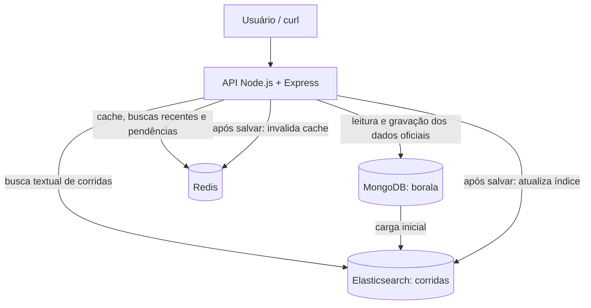

# Bora Lá — Checkpoint 2

**Disciplina:** Banco de Dados NoSQL — UTFPR Guarapuava, 2026/2.

Neste checkpoint, o Bora Lá passou a usar os três bancos de forma integrada: MongoDB para os dados principais, Redis para cache e histórico de buscas, e Elasticsearch para pesquisa de corridas. As consultas e a modelagem do [Checkpoint 1](CHECKPOINT_1.md) foram mantidas.

## Seção 1 — Arquitetura e fonte da verdade

O MongoDB continua sendo a fonte da verdade do sistema. Isso significa que uma alteração de corrida é salva primeiro nele. Depois, a API invalida o cache no Redis e atualiza a cópia usada na busca do Elasticsearch.



| Tipo de dado | Onde é gravado primeiro | Cópias em outros bancos | Por quê? |
|---|---|---|---|
| Passageiros | MongoDB: `passageiros` | Nenhuma | São dados de cadastro e não precisam entrar na busca de corridas |
| Motoristas e veículos | MongoDB: `motoristas` | Nenhuma | O cadastro e a disponibilidade são consultados no MongoDB |
| Corridas | MongoDB: `corridas` | Redis: detalhe com TTL; Elasticsearch: campos de busca | O Redis evita consultas repetidas e o Elasticsearch permite pesquisa textual |
| Avaliações | MongoDB: `avaliacoes` | Nenhuma | São dados persistentes que não fazem parte da busca deste checkpoint |
| Buscas recentes de cada passageiro | Redis: List | Nenhuma | Histórico temporário, com ordem e quantidade limitadas |
| IDs de corridas com sincronização pendente | Redis: Set | O conteúdo da corrida continua no MongoDB | Permite tentar a indexação novamente sem duplicar IDs |

O Redis e o Elasticsearch não substituem o MongoDB nas decisões de edição e aceite. Se o índice de busca precisar ser reconstruído, os dados são lidos novamente do MongoDB.

## Seção 2 — Redis como cache

Foi criada a rota `GET /api/corridas/:id` com o padrão **cache-aside**:

1. A API procura a corrida no Redis.
2. Se encontrar, retorna os dados com `REDIS (CACHE HIT)`.
3. Se não encontrar, consulta o MongoDB, salva o resultado no Redis e retorna `MONGODB (CACHE MISS)`.

A chave usada é `borala:corrida:<id>`, com **TTL de 60 segundos**. Esse tempo foi escolhido porque o estado de uma corrida pode mudar rapidamente. Além do TTL, o cache é apagado com `DEL` após editar ou aceitar uma corrida.

Nos testes, a primeira leitura foi MISS e a segunda foi HIT, com os mesmos dados. Abaixo estão trechos das respostas obtidas; os demais campos da corrida foram omitidos para facilitar a leitura:

```json
{
  "origem_cache": "MONGODB (CACHE MISS)",
  "dados": {
    "_id": "6ae0cd15058063052d4154e6",
    "valor_estimado": 18.5
  }
}
```

```json
{
  "origem_cache": "REDIS (CACHE HIT)",
  "dados": {
    "_id": "6ae0cd15058063052d4154e6",
    "valor_estimado": 18.5
  }
}
```

O TTL conferido no teste foi de 60 segundos. Para consultar durante a demonstração:

```bash
docker compose exec -T redis redis-cli TTL "borala:corrida:$CORRIDA_ID"
```

IDs inválidos retornam `400` e corridas inexistentes retornam `404`, sem armazenar esses erros no cache. Se o Redis estiver fora do ar, a leitura continua pelo MongoDB e a resposta inclui um aviso. Se a invalidação falhar depois de uma escrita, a API informa que o cache pode continuar desatualizado até expirar.

## Seção 3 — Redis como estrutura de dados

Foi usada uma **List** para guardar as últimas dez buscas de cada passageiro. A chave segue o padrão `borala:buscas:passageiro:<id>`.

A busca recebe `passageiroId` como parâmetro opcional. Quando ele é informado, o termo pesquisado é registrado com estes comandos:

| Comando | Função |
|---|---|
| `LPUSH chave termo` | Coloca a busca mais recente no início |
| `LTRIM chave 0 9` | Mantém somente as dez últimas buscas |
| `EXPIRE chave 86400` | Define expiração de 24 horas |
| `LRANGE chave 0 9` | Recupera o histórico na ordem de recência |

A List foi escolhida porque a ordem das buscas importa e o mesmo termo pode aparecer mais de uma vez. Um Set não manteria essas repetições. O limite e a expiração evitam guardar esse histórico indefinidamente.

A consulta é feita em `GET /api/redis/buscas/:passageiroId`, que retorna a chave, o total e a lista de termos. No teste com 12 pesquisas, ficaram somente as dez mais recentes, na ordem correta. O tipo da chave foi confirmado como `list`.

Se o registro do histórico falhar, a busca no Elasticsearch continua funcionando. O ID do passageiro é validado, mas o sistema ainda não possui autenticação para comprovar a identidade de quem faz a consulta.

## Seção 4 — Elasticsearch: mapping e indexação

O índice usado é `corridas`. O mapping completo está em [init/elastic-init.json](init/elastic-init.json), sem o parâmetro `boost`.

| Campo | Tipo | Motivo |
|---|---|---|
| `origem` e `destino` | `text` | São endereços pesquisados por palavras, com relevância e tolerância a erros |
| `corrida_id`, `passageiro_id` e `motorista_id` | `keyword` | São identificadores usados para igualdade exata |
| `status` | `keyword` | Permite filtrar pelo estado exato da corrida |
| `valor_estimado` e `distancia_estimada_km` | `float` | São valores numéricos |
| `data_solicitacao` | `date` | Representa a data da solicitação |

Os campos de endereço usam o analyzer `texto_ptbr`, com tokenizer `standard` e filtros `lowercase` e `asciifolding`. Assim, a pesquisa ignora diferenças de maiúsculas e acentos. Por exemplo, `Rodoviario` encontra `Rodoviário`. Não foi implementado tratamento de plural ou raiz das palavras.

A função `montarDocumentoBusca` transforma a corrida do MongoDB no documento do índice. Ela usa `origem.endereco` e `destino.endereco` como textos, converte os IDs para strings e copia apenas os campos necessários para a pesquisa. Dados de cadastro, como `senha_hash`, não são indexados.

O script `app/src/scripts/seed-elastic.ts` faz a carga das corridas do MongoDB para o Elasticsearch. Ele usa o ID da corrida como ID do documento e faz refresh ao terminar. A mesma função de conversão é usada nas atualizações, para manter o formato dos documentos.

Essa carga acontece automaticamente ao executar `./iniciar.sh`. O ambiente aguarda os bancos ficarem disponíveis e executa o seed antes de a API começar a atender. Na partida do container da API, o índice é recriado a partir do MongoDB; os dados oficiais e os volumes não são apagados. Durante essa preparação, a API ainda não está disponível.

Nos testes, o MongoDB e o Elasticsearch tinham **8 corridas**. A contagem pode ser conferida com:

```bash
curl -fsS http://localhost:9234/corridas/_count
docker compose exec -T mongo mongosh -u root -p root --quiet \
  --eval 'print(db.getSiblingDB("borala").corridas.countDocuments())'
```

O ElasticVue fica em `http://localhost:8400`, e o Elasticsearch no host fica em `http://localhost:9234`. Dentro dos containers, a API acessa `http://elasticsearch:9200`.

## Seção 5 — Elasticsearch: busca

Foi criada a rota `GET /api/busca/corridas`, com `q` obrigatório e os parâmetros opcionais `status` e `passageiroId`.

A busca usa `multi_match` em dois campos, com pesos diferentes:

- `origem^3`: recebe maior peso porque o local de embarque é mais relevante para o motorista.
- `destino^2`: também participa da pesquisa, com peso um pouco menor.

A opção `fuzziness: "AUTO"` permite encontrar resultados mesmo com pequenos erros de digitação. O filtro de status é aplicado dentro da consulta do Elasticsearch, usando `bool.filter` com `term`.

Exemplo da consulta usada para pesquisar `UTFP` entre as corridas que aguardam motorista:

```json
{
  "query": {
    "bool": {
      "must": [
        {
          "multi_match": {
            "query": "UTFP",
            "fields": ["origem^3", "destino^2"],
            "fuzziness": "AUTO"
          }
        }
      ],
      "filter": [
        { "term": { "status": "aguardando_motorista" } }
      ]
    }
  }
}
```

No teste, `UTFP` encontrou a corrida com destino **UTFPR Guarapuava**, mesmo faltando a letra R. A consulta filtrada retornou apenas corridas com status `aguardando_motorista`.

A resposta traz o total encontrado e até 20 resultados, com ID da corrida, origem, destino, status, valor estimado e `_score`. O texto deve ter entre 1 e 200 caracteres. Texto vazio, status inválido ou ID malformado retornam `400`.

## Seção 6 — Integração e sincronização

A rota `PATCH /api/corridas/:id` permite alterar endereço de origem, endereço de destino e valor estimado, desde que a corrida ainda esteja em `aguardando_motorista`. Campos como status, motorista e datas não podem ser alterados por essa rota. A validação também rejeita preço não positivo, endereço vazio e campos desconhecidos.

A atualização segue esta ordem:

1. Salva a alteração no MongoDB.
2. Apaga o cache da corrida no Redis.
3. Lê a versão atual da corrida no MongoDB e atualiza o documento completo no Elasticsearch.
4. Remove a pendência se a indexação funcionou ou registra o ID para tentar novamente se houve falha.

A rota de aceite do Checkpoint 1, `PATCH /api/corridas/:id/aceitar`, também passou a invalidar o cache e atualizar o Elasticsearch. A condição atômica no MongoDB foi mantida para impedir que a mesma corrida seja aceita duas vezes. No teste com duas tentativas simultâneas, uma retornou `200` e a outra `409`.

**Depois de uma alteração, quando cada banco mostra o dado novo?**

O MongoDB mostra o valor oficial assim que a gravação termina. Com a invalidação do Redis, o próximo GET é MISS e busca o valor atualizado no MongoDB; a leitura seguinte já é HIT. No Elasticsearch, a indexação usa `refresh: "wait_for"`, então a sincronização só é confirmada quando a alteração já pode aparecer na busca, após o refresh.

**E se o MongoDB salvar, mas o Elasticsearch falhar?**

A alteração continua salva no MongoDB. A API retorna `202`, informando que a sincronização ficou pendente, e usa `SADD` na chave `borala:sync:pendentes` para guardar o ID. O Set evita repetir o mesmo ID na fila.

```json
{
  "mongodb": "SALVO",
  "redis": "INVALIDADO",
  "elasticsearch": "PENDENTE",
  "pendencia": "REGISTRADA",
  "concluida": false
}
```

`GET /api/sincronizacao/pendentes` lista os IDs com `SMEMBERS`. `POST /api/sincronizacao/reprocessar` consulta novamente os dados atuais no MongoDB e tenta indexar. O ID só é removido com `SREM` depois de a indexação funcionar.

No teste de falha, o preço foi alterado de 21.75 para 22.25 e depois para 23.25, sem atualizar o Elasticsearch. O MongoDB ficou com 23.25 e o índice ainda mostrava 21.75. O Set manteve um único ID. Após o reprocessamento, o índice passou a mostrar 23.25 e a lista de pendências ficou vazia.

Para demonstrar esse caso, a rota aceita `?simular_falha=elastic` somente com `NODE_ENV=development` e `PERMITIR_SIMULACAO_FALHA=true`. A simulação fica desativada por padrão e foi testado que ela é rejeitada em produção.

Há algumas limitações: se o Redis também estiver indisponível, a pendência pode não ser registrada; nesse caso, a API informa a falha e a recuperação depende da reindexação a partir do MongoDB. Não há uma transação única entre os três bancos. O cache também não oferece consistência forte em todos os cenários de leitura e escrita simultâneas. Além disso, a edição de endereço preserva as coordenadas existentes, que precisariam ser recalculadas em um sistema com geocodificação.

## Seção 7 — Roteiro de demonstração

Os comandos abaixo mostram o funcionamento em sequência. Para iniciar, basta ter Docker e Docker Compose disponíveis. O roteiro usa também `curl` e Python 3 no host para obter os IDs automaticamente.

As saídas descritas são as **esperadas**. Como os comandos de edição e aceite alteram corridas, a demonstração deve ser feita em uma instância de teste com os dados iniciais.

1. Clonar o projeto e iniciar o ambiente de desenvolvimento com a simulação habilitada:

```bash
git clone <URL_DO_REPOSITORIO_DA_EQUIPE>
cd base-nosql-docker
NODE_ENV=development PERMITIR_SIMULACAO_FALHA=true ./iniciar.sh
export API=http://localhost:3400
curl -fsS "$API/api/health"
curl -fsS http://localhost:9234/corridas/_count
```

Saída esperada: health `OK`, três bancos `ONLINE` e índice com 8 documentos nos dados iniciais. Se já houver outros dados, a contagem deve ser comparada com a do MongoDB.

2. Obter os IDs das corridas e testar o cache:

```bash
export CORRIDA_ID=$(curl -fsS "$API/api/corridas/disponiveis" | python3 -c \
 'import json,sys; print(next(c["_id"] for c in json.load(sys.stdin)["dados"] if c["destino"]["endereco"]=="UTFPR Guarapuava"))')
export ACEITE_ID=$(curl -fsS "$API/api/corridas/disponiveis" | python3 -c \
 'import json,sys,os; print(next(c["_id"] for c in json.load(sys.stdin)["dados"] if c["_id"]!=os.environ["CORRIDA_ID"]))')
docker compose exec -T redis redis-cli DEL "borala:corrida:$CORRIDA_ID"
curl -fsS "$API/api/corridas/$CORRIDA_ID"
curl -fsS "$API/api/corridas/$CORRIDA_ID"
docker compose exec -T redis redis-cli TTL "borala:corrida:$CORRIDA_ID"
export PASSAGEIRO_ID=$(curl -fsS "$API/api/corridas/$CORRIDA_ID" | python3 -c \
 'import json,sys; print(json.load(sys.stdin)["dados"]["passageiro_id"])')
```

Saída esperada: primeiro GET com `MONGODB (CACHE MISS)`, segundo com `REDIS (CACHE HIT)` e TTL entre 1 e 60. O `DEL` remove somente a chave dessa corrida para garantir o MISS. A seleção considera os dados iniciais, com duas corridas disponíveis e uma delas com destino UTFPR.

3. Testar a busca e o histórico no Redis:

```bash
curl -fsSG "$API/api/busca/corridas" --data-urlencode 'q=UTFPR'
curl -fsSG "$API/api/busca/corridas" --data-urlencode 'q=UTFP' \
  --data-urlencode 'status=aguardando_motorista' --data-urlencode "passageiroId=$PASSAGEIRO_ID"
curl -fsS "$API/api/redis/buscas/$PASSAGEIRO_ID"
docker compose exec -T redis redis-cli TYPE "borala:buscas:passageiro:$PASSAGEIRO_ID"
docker compose exec -T redis redis-cli LRANGE "borala:buscas:passageiro:$PASSAGEIRO_ID" 0 9
for n in {1..12}; do
  curl -fsSG "$API/api/busca/corridas" --data-urlencode "q=consulta$n" \
    --data-urlencode "passageiroId=$PASSAGEIRO_ID"
done
curl -fsS "$API/api/redis/buscas/$PASSAGEIRO_ID"
```

Saída esperada: `UTFPR` e `UTFP` encontram a corrida da UTFPR. Com o filtro, todos os resultados têm status `aguardando_motorista`. O histórico começa com `UTFP`, e o comando `TYPE` retorna `list`. Depois das 12 consultas, ficam dez itens, de `consulta12` a `consulta3`, nessa ordem.

4. Alterar o destino e conferir as cópias atualizadas:

```bash
curl -fsS -X PATCH "$API/api/corridas/$CORRIDA_ID" -H 'Content-Type: application/json' \
  -d '{"destino":{"endereco":"Terminal Rodoviário, Guarapuava - PR"},"valor_estimado":21.75}'
curl -fsS "$API/api/corridas/$CORRIDA_ID"
curl -fsS "$API/api/corridas/$CORRIDA_ID"
curl -fsSG "$API/api/busca/corridas" --data-urlencode 'q=Rodoviario' \
  --data-urlencode 'status=aguardando_motorista'
curl -fsSG "$API/api/busca/corridas" --data-urlencode 'q=UTFP' \
  --data-urlencode 'status=aguardando_motorista'
```

Saída esperada: PATCH com HTTP `200` e `sincronizacao.concluida: true`. Os GETs retornam MISS e depois HIT, com destino atualizado e valor 21.75. `Rodoviario` encontra a corrida, e `UTFP` não encontra mais essa corrida com o filtro aplicado.

5. Simular uma falha no Elasticsearch e reprocessar:

```bash
curl -sS -w '\nHTTP %{http_code}\n' -X PATCH \
  "$API/api/corridas/$CORRIDA_ID?simular_falha=elastic" -H 'Content-Type: application/json' \
  -d '{"valor_estimado":22.25}'
curl -fsS "$API/api/corridas/$CORRIDA_ID"
curl -fsS "$API/api/sincronizacao/pendentes"
curl -fsS -X POST "$API/api/sincronizacao/reprocessar"
curl -fsS "$API/api/sincronizacao/pendentes"
curl -fsSG "$API/api/busca/corridas" --data-urlencode 'q=Rodoviario'
```

Saída esperada: PATCH com HTTP `202`, `mongodb: "SALVO"` e `elasticsearch: "PENDENTE"`. O detalhe mostra 22.25 e a consulta de pendências mostra um ID. O reprocessamento retorna esse ID em `reprocessados`; depois, `quantidade` fica em zero e a busca mostra o preço 22.25. Sem habilitar a simulação no início, o PATCH retorna `400` e não altera a corrida.

6. Conferir o aceite e as consultas do Checkpoint 1:

```bash
export MOTORISTA_ID=$(docker compose exec -T mongo mongosh -u root -p root --quiet \
  --eval 'print(db.getSiblingDB("borala").motoristas.findOne({disponivel:true})._id.toString())')
curl -fsS "$API/api/corridas/$ACEITE_ID"
curl -fsS -X PATCH "$API/api/corridas/$ACEITE_ID/aceitar" -H 'Content-Type: application/json' \
  -d "{\"motorista_id\":\"$MOTORISTA_ID\"}"
docker compose exec -T redis redis-cli EXISTS "borala:corrida:$ACEITE_ID"
curl -sS -w '\nHTTP %{http_code}\n' -X PATCH "$API/api/corridas/$ACEITE_ID/aceitar" \
  -H 'Content-Type: application/json' -d "{\"motorista_id\":\"$MOTORISTA_ID\"}"
curl -fsS "$API/api/corridas/passageiro/$PASSAGEIRO_ID"
curl -fsS "$API/api/corridas/motorista/$MOTORISTA_ID"
curl -fsS "$API/api/corridas/filtro?status=finalizada&valorMin=10&valorMax=30"
curl -fsSG "$API/api/busca/corridas" --data-urlencode 'q=Guarapuava' \
  --data-urlencode 'status=aguardando_motorista'
```

Saída esperada: primeiro aceite com HTTP `200`, chave removida (`EXISTS = 0`) e segunda tentativa com `409`. Os históricos retornam as corridas dos respectivos IDs, e o filtro retorna corridas finalizadas entre 10 e 30. A busca por corridas aguardando motorista não inclui a corrida aceita.

7. Executar os testes automatizados:

```bash
(cd app && npm ci && npm run build)
bash -n iniciar.sh
bash -n reset.sh
bash -n scripts/validar-checkpoint-2.sh
docker compose config --quiet
git diff --check
./scripts/validar-checkpoint-2.sh
```

O script de validação cria um ambiente separado, com seus próprios containers, rede e volumes. Ele usa a API na porta 13400 e o Elasticsearch na 19234, testa as rotas com `curl` e para os containers de teste ao terminar. Os volumes existentes do projeto não são apagados. Essas portas precisam estar livres.

**Resultados dos testes realizados:**

| Teste | Resultado |
|---|---|
| Instalação das dependências e build TypeScript | Passaram no host e no Docker |
| Sintaxe dos scripts, configuração do Compose e `git diff --check` | Passaram |
| Inicialização automática em ambiente novo | Três bancos disponíveis e 8 corridas no índice |
| Teste de integração | 28 verificações passaram, incluindo as rotas do Checkpoint 1 |
| Cache | MISS, HIT, TTL e invalidação após edição e aceite confirmados |
| Histórico Redis | Dez buscas mais recentes na ordem correta |
| Busca | Erro de digitação, acentos e filtro de status confirmados |
| Falha de indexação | Pendência registrada e recuperada com a versão atual do MongoDB |
| Aceites simultâneos | Uma resposta `200` e uma `409` |
| Redis fora do ar | Detalhe pelo MongoDB e busca funcionando; histórico `503` e health `207` |
| Simulação de falha em produção | Rejeitada com `400` |
| Preservação dos dados existentes | Contagens e hash dos documentos iguais antes e depois da inicialização |

A queda simultânea de Redis e Elasticsearch e a interrupção do processo entre a gravação e o registro da pendência não foram testadas. Nenhum teste precisou apagar os volumes ou executar o reset do banco.
