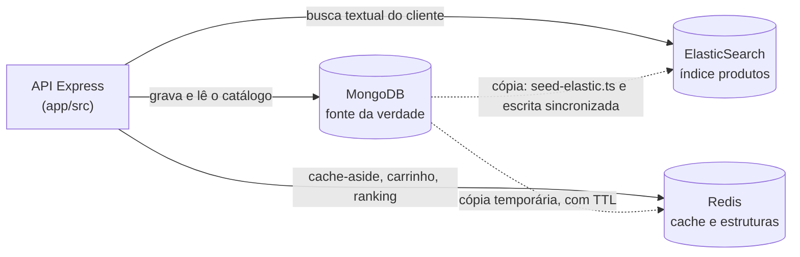

# Checkpoint 2 — PopsMarket
**Disciplina:** Banco de Dados NoSQL (TSI34E-TSI4) — UTFPR Câmpus Guarapuava
**Professor:** Prof. Marcelo Marcos Vichar Junior
**Equipe:** Matheus Popolin · Sara Pereira de Almeida
**Entrega:** 25/10/2026, até 23h59, branch `main`

O **PopsMarket** é um marketplace que conecta vendedores independentes a clientes finais. Este documento descreve como os três bancos NoSQL trabalham juntos no projeto: o MongoDB guarda o catálogo, o Redis responde ao que precisa ser imediato e o ElasticSearch atende a busca digitada pelo cliente.

---

## 1. Arquitetura e fonte da verdade (15 pontos)



| Dado | Fonte da verdade | Cópias | Por que existe a cópia |
| :--- | :--- | :--- | :--- |
| Produtos (nome, preço, estoque, especificações) | MongoDB, coleção `produtos` | Redis (`popsmarket:produto:<id>`, `popsmarket:produtos:recentes`, `popsmarket:produtos:categoria:*`) e ElasticSearch (índice `produtos`) | A vitrine e a tela do produto são as telas mais abertas do marketplace; a busca digitada precisa de relevância e tolerância a erro, que o MongoDB não oferece |
| Vendedores | MongoDB, coleção `vendedores` | ElasticSearch (campo `vendedor_nome` dentro de cada produto) e Redis (`popsmarket:vendedor:<id>:produtos`) | O cliente também procura o produto pelo nome da loja ("TechStore"), e o ElasticSearch não faz JOIN: o nome precisa estar dentro do documento do produto |
| Pedidos | MongoDB, coleção `pedidos` | **Nenhuma** | Registro financeiro: não pode se perder nem ser lido desatualizado. Cada pedido já guarda o preço praticado (snapshot), então nada do cache o afeta |
| Clientes | MongoDB, coleção `clientes` | **Nenhuma** | Dado cadastral, lido poucas vezes por sessão; cachear traria risco de mostrar endereço antigo no checkout sem ganho real |
| Carrinho de compras | **Redis**, Hash `popsmarket:carrinho:cliente:<id>` | MongoDB, coleção `carrinhos` (apenas quando o pedido é fechado) | Dado temporário, alterado a cada clique. Vive no Redis com TTL de 24h; ao finalizar a compra, vira um pedido no MongoDB |
| Ranking de mais vendidos | MongoDB (derivável de `pedidos`) | Redis, Sorted Set `popsmarket:ranking:produtos` | Recalcular o ranking com uma agregação sobre `pedidos` a cada abertura do aplicativo seria caro; o Sorted Set já mantém a ordem a cada venda |
| Categorias ativas | MongoDB (campo `categorias` dos produtos) | Redis, Set `popsmarket:categorias:ativas` | Validar a categoria no cadastro de um produto com `SISMEMBER` é O(1) e evita ir ao MongoDB |

**Se o Redis for apagado**, o PopsMarket perde apenas os carrinhos abertos e o ranking acumulado; todo o resto é recalculado na primeira leitura, porque é cópia de algo que está no MongoDB.
**Se o índice `produtos` for apagado**, o `./iniciar.sh` ou a rota `POST /api/busca/reindexar` o recriam inteiro a partir da coleção `produtos`.
**Se o MongoDB for perdido**, não há de onde reconstruir: é por isso que ele é a fonte da verdade.

---

## 2. Redis como cache (15 pontos)

**Rota:** `GET /api/produtos/detalhes/:id` — `app/src/controllers/produtos.controller.ts`, método `detalharCacheado`.

O padrão **cache-aside** em três passos:

1. Consulta a chave `popsmarket:produto:<id>` no Redis. Se existir, responde `origem: "REDIS (CACHE HIT)"`.
2. Se não existir, busca o produto no MongoDB com um `$lookup` que já traz o vendedor junto.
3. Grava o resultado pronto no Redis com **TTL de 600 segundos** e responde `origem: "MONGODB (CACHE MISS)"`.

**Por que 10 minutos:** o preço, o estoque e a descrição de um produto mudam poucas vezes por dia, e **toda alteração feita pela aplicação apaga a chave na hora** (Seção 6). O TTL não é o mecanismo principal de atualização — é só a proteção para alterações feitas por fora da API, por exemplo direto no Mongo Express. Dez minutos é o limite que aceitamos ver um preço velho nesse caso excepcional.

**As cinco rotas de leitura com cache e seus TTLs:**

| Rota | Chave | TTL | Por que esse tempo |
| :--- | :--- | ---: | :--- |
| `GET /api/produtos?q=` | `popsmarket:produtos:busca:<q\|categoria\|vendedor\|preco_max>` | 300 s | A busca é a consulta mais cara do catálogo; o acervo muda poucas vezes ao dia |
| `GET /api/produtos/recentes` | `popsmarket:produtos:recentes` | 120 s | É a lista mais volátil: todo cadastro novo a altera, então o TTL é curto |
| `GET /api/produtos/categoria/:categoria` | `popsmarket:produtos:categoria:<categoria>` | 300 s | Vitrine de categoria: muito lida e pouco alterada |
| `GET /api/produtos/detalhes/:id` | `popsmarket:produto:<id>` | 600 s | Produto individual, o dado mais estável do catálogo |
| `GET /api/vendedor/:id/produtos` | `popsmarket:vendedor:<id>:produtos` | 300 s | Painel do vendedor, lido a cada acesso da loja |

**Quando o cache é invalidado:** em **toda** rota de escrita (`POST`, `PUT`, `PATCH`, `DELETE` de `/api/produtos`), antes mesmo de tocar no ElasticSearch. A função `invalidarCacheProdutos` (`app/src/services/cache-produtos.ts`) apaga:

- `popsmarket:produto:<id>` — o detalhe do produto alterado;
- `popsmarket:vendedor:<id>:produtos` — a vitrine do vendedor dono do produto;
- `popsmarket:produtos:recentes` — a lista de recentes;
- `popsmarket:produtos:categoria:*` — todas as vitrines de categoria;
- `popsmarket:produtos:busca:*` — todos os resultados de busca memorizados.

As duas últimas usam **padrão** porque um produto pertence a várias categorias e pode aparecer em qualquer busca já memorizada: não há como saber de antemão quais chaves ficaram desatualizadas. A varredura usa **`SCAN` + `UNLINK`**, nunca `KEYS` — o `KEYS` percorre o keyspace inteiro de uma vez e bloqueia o Redis para todos os outros clientes.

---

## 3. Redis como estrutura de dados (10 pontos)

**Padrão de nomes das chaves:** `popsmarket:<entidade>:<id>`, por exemplo `popsmarket:produto:6ad9...`, `popsmarket:carrinho:cliente:6ad9...`, `popsmarket:ranking:produtos`.

### 3.1. Hash — carrinho de compras do cliente

**Chave:** `popsmarket:carrinho:cliente:<cliente_id>` · **Rotas:** `app/src/controllers/estruturas-redis.controller.ts`

- `POST /api/redis/carrinho/:cliente_id` — `HSET` cria o carrinho e `EXPIRE` lhe dá 24h de vida.
- `PATCH /api/redis/carrinho/:cliente_id/adicionar-item` — `HINCRBY` soma à quantidade e ao valor total.
- `GET /api/redis/carrinho/:cliente_id` — `HGETALL` devolve o carrinho inteiro.

**Por que um Hash:** o carrinho é alterado **campo a campo** a cada clique do cliente. Com um Hash, o `HINCRBY` soma à quantidade de forma **atômica**, sem ler e regravar o carrinho inteiro — se o cliente adicionar dois itens em sequência rápida, nenhum dos dois se perde. Guardar o carrinho como uma String JSON exigiria ler, desserializar, alterar e gravar de volta, abrindo espaço para uma atualização sobrescrever a outra. O carrinho ainda é um dado temporário: o `EXPIRE` faz o carrinho abandonado desaparecer sozinho, sem rotina de limpeza.

### 3.2. Sorted Set — ranking de produtos mais vendidos

**Chave:** `popsmarket:ranking:produtos`

- `POST /api/redis/ranking/venda` — `ZINCRBY` soma a venda ao score do produto.
- `GET /api/redis/ranking/top?limite=3` — `ZREVRANGE ... WITHSCORES` traz os primeiros colocados já ordenados.

**Por que um Sorted Set:** o Redis mantém os membros ordenados pelo score a cada incremento, em O(log N); a leitura do top N é O(log N + M). Uma **List** exigiria ordenar na aplicação a cada consulta e um **Hash** não tem ordem nenhuma. A alternativa sem Redis seria uma agregação sobre a coleção `pedidos` a cada abertura do aplicativo — justamente a consulta cara que queremos evitar na tela inicial.

### 3.3. Set — categorias ativas do marketplace

**Chave:** `popsmarket:categorias:ativas` (carregada por `init/redis-init.commands`)

`SADD` / `SMEMBERS` / `SISMEMBER` (`GET /api/redis/categorias`, `GET /api/redis/categorias/verificar?categoria=`). **Por que um Set:** validar se uma categoria existe no cadastro de um produto é `SISMEMBER`, O(1), e o Set elimina duplicatas sozinho — não é possível cadastrar "Eletrônicos" duas vezes.

### 3.4. List — fila de sincronização pendente

**Chave:** `popsmarket:sync:pendentes` — usada na Seção 6. **Por que uma List:** a fila precisa preservar a **ordem de chegada** (FIFO, `RPUSH` + `LPOP`): o produto que falhou primeiro é o primeiro a ser reprocessado.

---

## 4. ElasticSearch: mapping e indexação (15 pontos)

**Mapping:** `init/elastic-init.json`, índice `produtos`, com o analisador **`texto_ptbr`** (minúsculas → palavras vazias do português → plural → acentos). É por causa dele que "Notebooks Gamers Básicos" vira `["notebook", "gamer", "basico"]` no índice, e que buscar "notebooks" encontra "Notebook".

> O mapping **não usa o parâmetro `boost`**, removido no ElasticSearch 8. O peso de cada campo não se perdeu: passou a ser informado **na consulta**, em `fields: ["nome^4", ...]` (Seção 5).

| Campo | Tipo | Motivo |
| :--- | :--- | :--- |
| `nome`, `descricao`, `vendedor_nome`, `especificacoes_texto` | `text` (`texto_ptbr`) | O cliente digita livremente; precisam ser analisados em termos, pontuados por relevância e tolerar erro de digitação |
| `produto_id`, `vendedor_id`, `categorias` | `keyword` | São comparados por **valor exato** dentro de filtros. "Eletrônicos" precisa casar inteiro: se fosse `text`, a categoria seria quebrada em termos e "Casa" casaria com "Casa & Conforto" |
| `preco`, `avaliacao_media` | `float` | Permitem filtro por faixa (`range`), como `preco_max` |
| `estoque` | `integer` | Quantidade inteira, usada em filtro por faixa |
| `disponivel` | `boolean` | Filtro de sim ou não, aplicado em toda busca |
| `data_criacao` | `date` | Ordenação e filtro por período |

### Do MongoDB para o índice

- **Carga completa** — `app/src/scripts/seed-elastic.ts`. Lê as coleções `produtos` e `vendedores`, monta um documento por produto com `montarDocumentoBusca` e usa o **`_id` do MongoDB como `id` do documento no índice**. O `./iniciar.sh` executa essa carga ao subir o ambiente, e a rota `POST /api/busca/reindexar` a repete sob demanda.
- **Alteração de um produto** — a rota de escrita (Seção 6) reusa a **mesma** função `montarDocumentoBusca` e indexa **apenas aquele documento**, pelo `_id`. Reusar a função é o que garante que um produto alterado fique idêntico a um produto vindo da carga completa.
- **Desnormalização** — o `vendedor_nome` é copiado para dentro de cada produto porque o ElasticSearch não faz JOIN, e as `especificacoes` (que variam de produto para produto: processador, material, numeração) são achatadas em `especificacoes_texto`, para que a busca encontre "i5" ou "AMOLED" sem precisar de um mapping por atributo.

---

## 5. ElasticSearch: busca (15 pontos)

**Rota:** `GET /api/produtos?q=<texto>&categoria=<categoria>&vendedor_id=<id>&preco_max=<valor>`
`app/src/controllers/busca.controller.ts`, método `buscarProdutos`.

```ts
query: {
  bool: {
    must:   { multi_match: { query: termo, fields: CAMPOS_BUSCA, fuzziness: "AUTO" } },
    filter: filtros,
  },
}
```

**Vários campos com pesos** — `CAMPOS_BUSCA = ["nome^4", "descricao^2", "vendedor_nome^2", "especificacoes_texto"]`:

| Campo | Peso | Por que esse peso |
| :--- | :---: | :--- |
| `nome` | 4 | É o que o cliente digita e lembra. Um acerto no nome do produto deve sempre vencer um acerto em qualquer outro campo |
| `descricao` | 2 | Resume o produto e costuma conter o termo procurado, mas de forma mais diluída que o nome |
| `vendedor_nome` | 2 | Num marketplace o cliente também procura pela loja ("TechStore"); vale o mesmo que a descrição |
| `especificacoes_texto` | 1 | Termos técnicos como "Bluetooth" ou "SSD" aparecem em muitos produtos; com peso alto, empurrariam itens pouco relevantes para o topo |

**Tolerância a erro de digitação** — `fuzziness: "AUTO"`. O ElasticSearch aceita um número de edições proporcional ao tamanho da palavra, então `notbook lenovu` encontra o `Notebook Lenovo IdeaPad 3` (Seção 7.5).

**Filtros exatos** — `bool` com `filter`, que **não altera a pontuação**: só decide quais produtos entram no conjunto. `disponivel: true` é aplicado **sempre** (a Mochila Antifurto, com `disponivel: false`, nunca aparece); `categorias`, `vendedor_id` e a faixa `preco` entram quando informados. Colocar esses recortes em `filter` em vez de `must` também permite ao ElasticSearch reaproveitá-los em cache, já que não precisam ser pontuados.

Quando `q` não é informado, a rota vira uma **vitrine filtrada**: o `match_all` pontua todos igualmente e os filtros fazem o recorte.

---

## 6. Integração e sincronização (20 pontos)

**Rota:** `PATCH /api/produtos/:id` — `produtos.controller.ts`, método `alterar`. As demais escritas (`POST`, `PUT`, `DELETE`) seguem exatamente os mesmos passos.

1. **MongoDB** — `findOneAndUpdate` com `returnDocument: "after"` grava a alteração e devolve o produto já alterado. Se este passo falhar, nada mudou em lugar nenhum e a rota responde erro.
2. **Redis** — `invalidarCacheProdutos` apaga o detalhe do produto e todas as listas que o exibem (Seção 2).
3. **ElasticSearch** — `index` com o `_id` do produto substitui **apenas aquele documento**, com `refresh: "wait_for"`.

A ordem importa: o Redis é invalidado **antes** do ElasticSearch, de modo que, mesmo se o índice falhar, a tela do produto já mostra o preço novo.

**1. Depois de uma alteração, em quanto tempo a busca e o cache passam a mostrar o dado novo?**

O **cache**, na leitura seguinte: a chave foi apagada no passo 2, então a próxima requisição é um `CACHE MISS`, vai ao MongoDB e já traz o valor novo. Não há espera.
A **busca**, assim que a requisição do `PATCH` termina: o `refresh: "wait_for"` faz a rota aguardar o documento ficar visível para a pesquisa antes de responder. Sem ele, o índice só atualizaria no próximo refresh automático — **até 1 segundo** — e uma busca feita logo em seguida ainda mostraria o preço antigo. A Seção 7.7 comprova: o `PATCH` responde e a busca seguinte já traz R$ 3.299,90.

**2. O que acontece se a gravação no MongoDB der certo e a atualização do ElasticSearch falhar?**

A alteração **não é desfeita** no MongoDB — ele é a fonte da verdade e já tem o dado correto; desfazer seria perder uma escrita válida por causa de um banco secundário. Em vez disso:

- o `_id` do produto é registrado na List `popsmarket:sync:pendentes` (`RPUSH`);
- a rota responde **`202 Accepted`** com `elasticsearch: "pendente"` — ou seja, "aceito e gravado, mas ainda não totalmente propagado";
- enquanto isso o sistema fica em **consistência eventual**: a busca mostra o valor antigo, mas a tela do produto já mostra o novo, porque o cache foi apagado no passo 2, antes do passo 3.

A rota `POST /api/produtos/sincronizacao/reprocessar` drena a fila: retira cada id com `LPOP` (ordem de chegada), **relê o produto atual no MongoDB** e o reindexa. Reler em vez de guardar o documento na fila garante que o índice receba o estado mais recente, mesmo que o produto tenha sido alterado outras vezes depois da falha. Se um produto tiver sido excluído enquanto estava pendente, ele é removido do índice. Ao final, o cache de busca (`popsmarket:produtos:busca:*`) também é invalidado — senão a busca continuaria devolvendo o resultado memorizado com o valor velho, mesmo com o índice já corrigido. Se o ElasticSearch ainda estiver fora, o id volta para a fila e nada se perde.

Para demonstrar esse caminho sem derrubar o container, toda rota de escrita aceita `?simular_falha=elastic` (Seção 7.8).

---

## 7. Roteiro de demonstração (10 pontos)

**Pré-requisito:** `git clone`, `./iniciar.sh` e `jq` instalado. As saídas abaixo foram capturadas em um ambiente recém-criado (`docker compose down -v` seguido de `./iniciar.sh`).

Os identificadores variam a cada carga do MongoDB. Para reproduzir, capture-os assim:

```bash
PID=$(curl -s --get 'http://localhost:3400/api/produtos' --data-urlencode 'q=notebook' | jq -r '.resultados[0].produto_id')
CID=$(docker exec nosql_mongo mongosh -u root -p root --quiet --eval 'db.getSiblingDB("popsmarket").clientes.findOne({nome:"Ana Silva"})._id.toString()')
VID=$(docker exec nosql_mongo mongosh -u root -p root --quiet --eval 'db.getSiblingDB("popsmarket").vendedores.findOne({nome:"TechStore Guarapuava"})._id.toString()')
```

### 7.0. O ambiente sobe do zero com os três bancos

```bash
curl -s http://localhost:3400/api/health | jq -c .
curl -s 'http://localhost:9234/produtos/_count' | jq -c '{count}'
curl -s 'http://localhost:9234/produtos/_mapping' | grep -c boost
```

```json
{"timestamp":"2026-10-22T00:35:43.429Z","status_geral":"OK","bancos":{"mongodb":{"status":"ONLINE","database":"popsmarket"},"redis":{"status":"ONLINE","resposta":"PONG"},"elasticsearch":{"status":"ONLINE","cluster_status":"green"}}}
{"count":8}
0
```

Os três bancos ONLINE, os 8 produtos já indexados pelo `./iniciar.sh` e **nenhuma ocorrência de `boost`** no mapping.

### 7.1. Cache: primeira leitura sem cache, segunda com cache

```bash
curl -s "http://localhost:3400/api/produtos/detalhes/$PID" | jq '{origem,tempo_resposta,chave,ttl_segundos,produto:{nome:.dados.nome,preco:.dados.preco,vendedor:.dados.vendedor.nome}}'
curl -s "http://localhost:3400/api/produtos/detalhes/$PID" | jq '{origem,tempo_resposta,chave,produto:{nome:.dados.nome,preco:.dados.preco,vendedor:.dados.vendedor.nome}}'
```

```json
{
  "origem": "MONGODB (CACHE MISS)",
  "tempo_resposta": "2.99 ms",
  "chave": "popsmarket:produto:6ad95a53ae7a45b53c8c6ce5",
  "ttl_segundos": 600,
  "produto": { "nome": "Notebook Lenovo IdeaPad 3", "preco": 3499.9, "vendedor": "TechStore Guarapuava" }
}
{
  "origem": "REDIS (CACHE HIT)",
  "tempo_resposta": "0.30 ms",
  "chave": "popsmarket:produto:6ad95a53ae7a45b53c8c6ce5",
  "produto": { "nome": "Notebook Lenovo IdeaPad 3", "preco": 3499.9, "vendedor": "TechStore Guarapuava" }
}
```

A segunda leitura é **10x mais rápida** (2,99 ms → 0,30 ms) e não encostou no MongoDB. As outras quatro rotas com cache se comportam igual:

```bash
curl -s http://localhost:3400/api/produtos/recentes            | jq -c '{origem,tempo_resposta,total}'
curl -s http://localhost:3400/api/produtos/recentes            | jq -c '{origem,tempo_resposta,total}'
curl -s http://localhost:3400/api/produtos/categoria/Casa      | jq -c '{origem,tempo_resposta,total}'
curl -s http://localhost:3400/api/produtos/categoria/Casa      | jq -c '{origem,tempo_resposta,total}'
curl -s "http://localhost:3400/api/vendedor/$VID/produtos"     | jq -c '{origem,tempo_resposta,total}'
curl -s "http://localhost:3400/api/vendedor/$VID/produtos"     | jq -c '{origem,tempo_resposta,total}'
```

```json
{"origem":"MONGODB (CACHE MISS)","tempo_resposta":"2.82 ms","total":7}
{"origem":"REDIS (CACHE HIT)","tempo_resposta":"0.35 ms","total":7}
{"origem":"MONGODB (CACHE MISS)","tempo_resposta":"2.27 ms","total":2}
{"origem":"REDIS (CACHE HIT)","tempo_resposta":"0.38 ms","total":2}
{"origem":"MONGODB (CACHE MISS)","tempo_resposta":"4.27 ms","total":3}
{"origem":"REDIS (CACHE HIT)","tempo_resposta":"0.35 ms","total":3}
```

### 7.2. Estrutura do Redis — Hash: carrinho de compras

```bash
curl -s -X POST "http://localhost:3400/api/redis/carrinho/$CID" \
  -H "Content-Type: application/json" -d '{"cliente_nome":"Ana Silva","status":"aberto"}' | jq '{estrutura,comando,chave,ttl_segundos}'

curl -s -X PATCH "http://localhost:3400/api/redis/carrinho/$CID/adicionar-item" \
  -H "Content-Type: application/json" -d '{"produto":"Fone de Ouvido Bluetooth JBL Tune 520","quantidade":2,"preco_unitario":249.90}' | jq '{comando,total_itens,valor_total}'

curl -s "http://localhost:3400/api/redis/carrinho/$CID" | jq '{comando,ttl_restante_segundos,carrinho}'
```

```json
{ "estrutura": "Hash", "comando": "HSET + EXPIRE", "chave": "popsmarket:carrinho:cliente:6ad95a53ae7a45b53c8c6ced", "ttl_segundos": 86400 }
{ "comando": "HINCRBY + HSET", "total_itens": 2, "valor_total": 499.8 }
{
  "comando": "HGETALL",
  "ttl_restante_segundos": 86400,
  "carrinho": {
    "cliente_nome": "Ana Silva",
    "status": "em_compra",
    "atualizado_em": "2026-10-22T00:37:47.688Z",
    "total_itens": "2",
    "valor_total_centavos": "49980",
    "ultimo_produto": "Fone de Ouvido Bluetooth JBL Tune 520"
  }
}
```

O `HINCRBY` somou 2 itens e R$ 499,80 sem reler o carrinho inteiro.

### 7.3. Estrutura do Redis — Sorted Set: ranking de mais vendidos

```bash
curl -s -X POST http://localhost:3400/api/redis/ranking/venda \
  -H "Content-Type: application/json" -d '{"produto":"Notebook Lenovo IdeaPad 3","quantidade":150}' | jq '{comando,produto,total_acumulado}'
curl -s "http://localhost:3400/api/redis/ranking/top?limite=3" | jq '{comando,ranking}'
```

```json
{ "comando": "ZINCRBY", "produto": "Notebook Lenovo IdeaPad 3", "total_acumulado": 248 }
{
  "comando": "ZREVRANGE 0 2 WITHSCORES",
  "ranking": [
    { "posicao": 1, "produto": "Fone de Ouvido Bluetooth JBL Tune 520", "vendas": 320 },
    { "posicao": 2, "produto": "Notebook Lenovo IdeaPad 3", "vendas": 248 },
    { "posicao": 3, "produto": "Smartphone Samsung Galaxy A54", "vendas": 210 }
  ]
}
```

O Notebook partiu de 98 (carga inicial em `init/redis-init.commands`), recebeu 150 e **subiu sozinho** da 4ª para a 2ª posição: nada foi ordenado pela aplicação.

### 7.4. Como o índice enxerga o texto (analisador `texto_ptbr`)

```bash
curl -s --get http://localhost:3400/api/busca/analisar --data-urlencode "texto=Notebooks Gamers Básicos" | jq .
```

```json
{
  "texto_original": "Notebooks Gamers Básicos",
  "analisador": "texto_ptbr",
  "termos_no_indice": ["notebook", "gamer", "basico"]
}
```

Plural e acento desaparecem: é por isso que "notebooks" encontra "Notebook".

### 7.5. Busca com erro de digitação

```bash
curl -s --get "http://localhost:3400/api/produtos" --data-urlencode "q=notbook lenovu" \
  | jq '{origem,termo,campos_e_pesos,total,resultados:[.resultados[]|{nome,vendedor,preco,relevancia}]}'
```

```json
{
  "origem": "ELASTICSEARCH (CACHE MISS)",
  "termo": "notbook lenovu",
  "campos_e_pesos": ["nome^4", "descricao^2", "vendedor_nome^2", "especificacoes_texto"],
  "total": 1,
  "resultados": [
    { "nome": "Notebook Lenovo IdeaPad 3", "vendedor": "TechStore Guarapuava", "preco": 3499.9, "relevancia": 11.62 }
  ]
}
```

Duas palavras escritas erradas e o produto foi encontrado, graças ao `fuzziness: "AUTO"`. A busca pelo **nome da loja** também funciona, porque `vendedor_nome` está no índice:

```bash
curl -s --get "http://localhost:3400/api/produtos" --data-urlencode "q=tecstore" | jq -c '{total,nomes:[.resultados[].nome]}'
```

```json
{"total":3,"nomes":["Notebook Lenovo IdeaPad 3","Smartphone Samsung Galaxy A54","Fone de Ouvido Bluetooth JBL Tune 520"]}
```

### 7.6. Busca com filtro exato

```bash
curl -s --get "http://localhost:3400/api/produtos" --data-urlencode "categoria=Eletrônicos" | jq -c '{total,nomes:[.resultados[].nome]}'
curl -s --get "http://localhost:3400/api/produtos" --data-urlencode "categoria=Eletrônicos" --data-urlencode "preco_max=300" | jq -c '{total,nomes:[.resultados[].nome]}'
curl -s --get "http://localhost:3400/api/produtos" --data-urlencode "q=fone blutooth" --data-urlencode "categoria=Moda" | jq -c '{total,nomes:[.resultados[].nome]}'
curl -s --get "http://localhost:3400/api/produtos" --data-urlencode "q=mochila" | jq -c '{total,nomes:[.resultados[].nome]}'
```

```json
{"total":3,"nomes":["Notebook Lenovo IdeaPad 3","Smartphone Samsung Galaxy A54","Fone de Ouvido Bluetooth JBL Tune 520"]}
{"total":1,"nomes":["Fone de Ouvido Bluetooth JBL Tune 520"]}
{"total":0,"nomes":[]}
{"total":0,"nomes":[]}
```

O `range` de preço cortou de 3 para 1 produto; o filtro de categoria "Moda" eliminou o fone, que é de "Áudio". A **Mochila Antifurto não aparece** na última busca porque está indisponível (`disponivel: false`) — o filtro `disponivel: true` é aplicado em toda busca.

### 7.7. Alteração de um registro, nova leitura e nova busca

```bash
curl -s -X PATCH "http://localhost:3400/api/produtos/$PID" \
  -H "Content-Type: application/json" -d '{"preco": 3299.90}' | jq '{mongodb,redis,elasticsearch,dados:{nome:.dados.nome,preco:.dados.preco}}'
curl -s "http://localhost:3400/api/produtos/detalhes/$PID" | jq -c '{origem,preco:.dados.preco}'
curl -s --get "http://localhost:3400/api/produtos" --data-urlencode "q=notebook" | jq -c '{origem,r:[.resultados[]|{nome,preco}]}'
```

```json
{
  "mongodb": "gravado",
  "redis": {
    "invalidado": true,
    "chaves_apagadas": [
      "popsmarket:produto:6ad95a53ae7a45b53c8c6ce5",
      "popsmarket:produtos:busca:notbook lenovu|||",
      "popsmarket:produtos:busca:fone blutooth|||",
      "popsmarket:produtos:busca:|Eletrônicos||",
      "popsmarket:produtos:busca:tecstore|||",
      "popsmarket:produtos:busca:|Eletrônicos||300",
      "popsmarket:produtos:busca:mochila|||"
    ]
  },
  "elasticsearch": "documento atualizado (1 documento)",
  "dados": { "nome": "Notebook Lenovo IdeaPad 3", "preco": 3299.9 }
}
{"origem":"MONGODB (CACHE MISS)","preco":3299.9}
{"origem":"ELASTICSEARCH (CACHE MISS)","r":[{"nome":"Notebook Lenovo IdeaPad 3","preco":3299.9}]}
```

Uma única requisição manteve os três bancos coerentes: a leitura seguinte voltou a ser `CACHE MISS` **já com o preço novo** (a cópia antiga foi apagada) e a busca também, graças ao `refresh: "wait_for"`.

### 7.8. Falha do ElasticSearch e reprocessamento

```bash
curl -s -D - -o /dev/null -X PATCH "http://localhost:3400/api/produtos/$PID?simular_falha=elastic" \
  -H "Content-Type: application/json" -d '{"preco": 2999.90}' | head -1
curl -s http://localhost:3400/api/produtos/sincronizacao/pendentes | jq -c .
curl -s --get "http://localhost:3400/api/produtos" --data-urlencode "q=notebook" | jq -c '[.resultados[]|{nome,preco}]'
curl -s "http://localhost:3400/api/produtos/detalhes/$PID" | jq -c '{origem,preco:.dados.preco}'
```

```
HTTP/1.1 202 Accepted
```
```json
{"estrutura":"List","chave":"popsmarket:sync:pendentes","total":1,"pendentes":["6ad95a53ae7a45b53c8c6ce5"]}
[{"nome":"Notebook Lenovo IdeaPad 3","preco":3299.9}]
{"origem":"MONGODB (CACHE MISS)","preco":2999.9}
```

Este é o estado de **consistência eventual**: o MongoDB e a tela do produto já mostram R$ 2.999,90; a busca ainda mostra R$ 3.299,90, porque o índice não foi atualizado. O id ficou registrado na fila. Agora o reprocessamento:

```bash
curl -s -X POST http://localhost:3400/api/produtos/sincronizacao/reprocessar | jq .
curl -s --get "http://localhost:3400/api/produtos" --data-urlencode "q=notebook" | jq -c '{origem,r:[.resultados[]|{nome,preco}]}'
```

```json
{
  "operacao": "reprocessamento da fila de sincronização",
  "chave": "popsmarket:sync:pendentes",
  "reindexados": ["6ad95a53ae7a45b53c8c6ce5"],
  "cache_de_busca_invalidado": ["popsmarket:produtos:busca:notebook|||"],
  "removidos_do_indice": [],
  "ainda_pendentes": [],
  "total_na_fila": 0
}
{"origem":"ELASTICSEARCH (CACHE MISS)","r":[{"nome":"Notebook Lenovo IdeaPad 3","preco":2999.9}]}
```

A fila esvaziou e a busca **convergiu** para o valor que está no MongoDB. Nenhuma escrita foi perdida.

### 7.9. Cadastro e exclusão sincronizados

```bash
NOVO=$(curl -s -X POST http://localhost:3400/api/produtos -H "Content-Type: application/json" -d "{
  \"nome\": \"Teclado Mecânico Gamer RGB\",
  \"descricao\": \"Teclado mecânico com switches azuis e iluminação RGB.\",
  \"preco\": 349.90, \"estoque\": 30, \"vendedor_id\": \"$VID\",
  \"categorias\": [\"Informática\", \"Acessórios\"],
  \"especificacoes\": { \"switch\": \"Azul\", \"layout\": \"ABNT2\" } }")
echo "$NOVO" | jq -c '{mongodb,elasticsearch,produto_id}'
NID=$(echo "$NOVO" | jq -r .produto_id)

curl -s --get "http://localhost:3400/api/produtos" --data-urlencode "q=teclado mecanico" | jq -c '[.resultados[]|{nome,preco}]'
curl -s -X DELETE "http://localhost:3400/api/produtos/$NID" | jq -c '{mongodb,elasticsearch}'
curl -s --get "http://localhost:3400/api/produtos" --data-urlencode "q=teclado mecanico" | jq -c '{total}'
```

```json
{"mongodb":"gravado","elasticsearch":"documento atualizado (1 documento)","produto_id":"6ad95ac45483f46b530f2670"}
[{"nome":"Teclado Mecânico Gamer RGB","preco":349.9}]
{"mongodb":"removido","elasticsearch":"documento removido do índice"}
{"total":0}
```

Um produto cadastrado agora é encontrado pela busca imediatamente; ao ser excluído, some do índice junto.

### 7.10. Reindexação completa (recuperação do índice)

```bash
curl -s -X POST http://localhost:3400/api/busca/reindexar | jq -c .
```

```json
{"operacao":"reindexação completa","fonte_da_verdade":"MongoDB (coleção produtos)","indice":"produtos","documentos_indexados":8}
```

Se o índice for perdido, o MongoDB o reconstrói inteiro — a demonstração prática de que ele é a fonte da verdade.

---

## Anexo — Arquivos relevantes

| Arquivo | Conteúdo |
| :--- | :--- |
| `init/elastic-init.json` | Mapping do índice `produtos` e analisador `texto_ptbr` (sem `boost`) |
| `init/redis-init.commands` | Chaves iniciais do Redis (Hash de config, Set de categorias, Sorted Set do ranking) |
| `init/mongo-init.js` | Carga das 6 coleções do PopsMarket |
| `iniciar.sh` | Sobe o ambiente, carrega o Redis e **cria e popula o índice de busca** |
| `app/src/scripts/seed-elastic.ts` | Carga do índice a partir do MongoDB + `montarDocumentoBusca` |
| `app/src/services/cache-produtos.ts` | Chaves de cache, TTLs e invalidação com `SCAN` |
| `app/src/controllers/produtos.controller.ts` | Leituras com cache-aside e escritas sincronizadas |
| `app/src/controllers/busca.controller.ts` | Busca `multi_match` + `fuzziness` + `bool.filter` |
| `app/src/controllers/estruturas-redis.controller.ts` | Hash, Sorted Set, Set e List |
