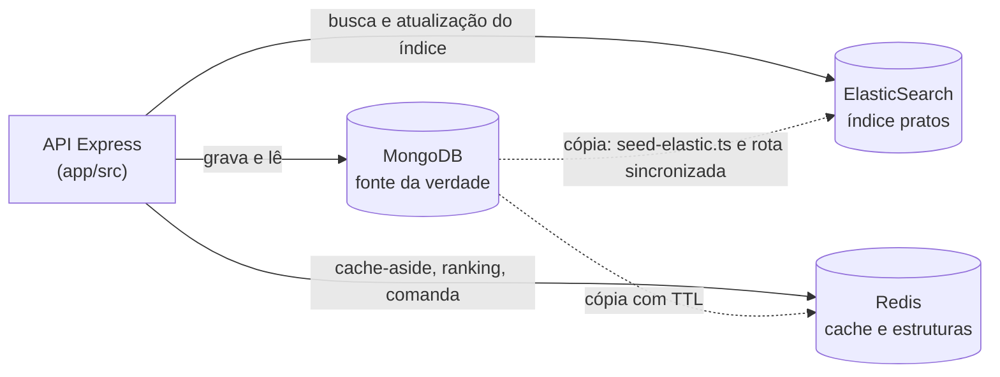

# Checkpoint 2 — Modelo de Referência: GastroHub
**Disciplina:** Banco de Dados NoSQL (TSI34E-TSI4) — UTFPR Câmpus Guarapuava  
**Professor:** Prof. Marcelo Vichar  
**Equipe de Exemplo:** GastroHub Core Team  
**Entrega:** 25/10/2026, até 23h59, branch `main`

---

> [!NOTE]
> **Aviso aos Estudantes:** este documento é o **modelo de referência** para o `CHECKPOINT_2.md` da equipe. O projeto de cada equipe tem tema próprio, mas deve seguir o mesmo nível de detalhe: cada escolha de banco justificada pelo domínio e cada item comprovado por um comando do roteiro da Seção 7.

---

## 1. Arquitetura e fonte da verdade (15 pontos)



| Dado | Fonte da verdade | Cópias | Por que existe a cópia |
| :--- | :--- | :--- | :--- |
| Cardápio (pratos, preços, disponibilidade) | MongoDB, coleção `cardapio` | Redis (`gastrohub:prato:<nome>` e `gastrohub:cardapio:economicos`) e ElasticSearch (índice `pratos`) | A tela do prato e a lista de econômicos são lidas a todo momento; a busca digitada pelo cliente precisa de relevância e tolerância a erro |
| Restaurantes | MongoDB, coleção `restaurantes` | ElasticSearch (campo `restaurante_nome` de cada prato) | O cliente encontra o prato também pelo nome do restaurante |
| Pedidos | MongoDB, coleção `pedidos` | Nenhuma | Registro financeiro: não pode se perder nem ficar desatualizado |
| Ranking dos mais vendidos | MongoDB (pedidos) | Redis, Sorted Set `gastrohub:ranking:pratos` | Consultar o ranking a cada abertura do aplicativo seria uma agregação cara; o Sorted Set já mantém a ordem |
| Comanda da mesa | Redis, Hash `gastrohub:comanda:mesa:<n>` | Nenhuma | Dado temporário, alterado a cada item pedido; ao fechar a conta, os itens devem ser gravados como pedido no MongoDB |

Se o Redis for apagado, o GastroHub perde apenas as comandas abertas; o resto é refeito a partir do MongoDB. Se o índice `pratos` for apagado, o `./iniciar.sh` ou `POST /api/busca/reindexar` o recria.

---

## 2. Redis como cache (15 pontos)

**Rota:** `GET /api/pratos/:nome` (`app/src/controllers/pratos.controller.ts`, método `buscarPorNome`).

1. Consulta a chave `gastrohub:prato:<nome>` no Redis. Se existir, responde `REDIS (CACHE HIT)`.
2. Se não existir, busca o prato no MongoDB.
3. Grava a cópia no Redis com **TTL de 300 segundos** e responde `MONGODB (CACHE MISS)`.

**Por que 5 minutos:** o preço de um prato muda poucas vezes por dia, e toda alteração feita pela aplicação apaga a chave na hora (Seção 6). O TTL é só uma proteção para alterações feitas fora da aplicação, como pelo Mongo Express.

**Invalidação:** a rota `PATCH /api/pratos/:nome` apaga `gastrohub:prato:<nome>` (e a do nome novo, se o nome mudou) e `gastrohub:cardapio:economicos`, porque a lista de econômicos também mostra o preço.

A rota `GET /api/cardapio/economicos` (Módulo 05) segue o mesmo padrão, com TTL de 60 segundos.

---

## 3. Redis como estrutura de dados (10 pontos)

**Caso de uso:** ranking dos pratos mais vendidos, exibido na tela inicial do aplicativo.

**Estrutura:** Sorted Set `gastrohub:ranking:pratos`, com o nome do prato como membro e a quantidade vendida como score.

- `POST /api/redis/ranking/venda` usa `ZINCRBY` para somar a venda ao score do prato.
- `GET /api/redis/ranking/top?limite=3` usa `ZREVRANGE ... WITHSCORES` para trazer os primeiros colocados, já ordenados.

**Por que Sorted Set:** o Redis mantém os membros ordenados pelo score a cada incremento. Uma List exigiria ordenar na aplicação e um Hash não tem ordem.

**Padrão de nomes das chaves:** `gastrohub:<entidade>:<id>`, por exemplo `gastrohub:prato:Prato Feito`, `gastrohub:comanda:mesa:12`, `gastrohub:sync:pendentes`.

---

## 4. ElasticSearch: mapping e indexação (15 pontos)

**Mapping:** `init/elastic-init.json`, com o analisador `texto_ptbr` (minúsculas, palavras vazias, plural e acento).

| Campo | Tipo | Motivo |
| :--- | :--- | :--- |
| `nome`, `descricao`, `ingredientes`, `restaurante_nome` | `text` | O cliente digita livremente; precisam de análise e relevância |
| `categoria`, `alergenos`, `prato_id`, `restaurante_id` | `keyword` | São comparados com um valor exato, em filtros |
| `preco` | `float` | Filtro por faixa de preço |
| `disponivel` | `boolean` | Filtro de sim ou não |

**Do MongoDB para o índice:**

- **Carga completa:** `app/src/scripts/seed-elastic.ts` lê `cardapio` e `restaurantes`, monta um documento por prato com `montarDocumentoBusca` e usa o `_id` do MongoDB como `id` do documento. O `./iniciar.sh` executa essa carga ao subir o ambiente.
- **Alteração de um prato:** a rota sincronizada atualiza apenas o documento daquele prato (Seção 6).

---

## 5. ElasticSearch: busca (15 pontos)

**Rota:** `GET /api/busca/cardapio?q=<texto>&categoria=<categoria>` (`busca.controller.ts`, método `buscarNoCardapio`).

- **Vários campos com pesos:** `multi_match` em `nome^3`, `descricao^2` e `ingredientes`. O nome vale mais porque é o que o cliente lembra; a descrição vem em seguida porque resume o prato; os ingredientes valem o peso normal porque citam itens de muitos pratos.
- **Erro de digitação:** `fuzziness: "AUTO"`.
- **Filtros exatos:** `bool` com `filter`, sempre com `disponivel: true` e, quando informada, `categoria`. Os filtros não alteram a pontuação, só decidem quais pratos entram.

---

## 6. Integração e sincronização (20 pontos)

**Rota:** `PATCH /api/pratos/:nome` (`pratos.controller.ts`, método `alterar`). A ordem dos passos:

1. **MongoDB:** `findOneAndUpdate` grava a alteração e devolve o prato já alterado. Se falhar, nada foi alterado em lugar nenhum.
2. **Redis:** apaga as chaves que dependem do prato (Seção 2).
3. **ElasticSearch:** `index` com o `_id` do prato substitui apenas aquele documento, com `refresh: "wait_for"`.

**1. Depois de uma alteração, em quanto tempo a busca e o cache mostram o dado novo?**  
O cache, na leitura seguinte: a chave foi apagada e a próxima leitura busca o valor no MongoDB. A busca, assim que a requisição termina: o `refresh: "wait_for"` faz a rota esperar o documento ficar visível (sem ele, levaria até 1 segundo, o intervalo de refresh do índice).

**2. O que acontece se a gravação no MongoDB der certo e a atualização do ElasticSearch falhar?**  
A alteração não é desfeita no MongoDB. O `_id` do prato é registrado na List `gastrohub:sync:pendentes` e a rota responde `202 Accepted`. A rota `POST /api/pratos/sincronizacao/reprocessar` retira cada pendência da fila, lê o prato **atual** no MongoDB e o indexa. Enquanto isso, a busca mostra o valor antigo, mas a tela do prato já mostra o novo, porque o cache foi apagado antes do passo 3.

---

## 7. Roteiro de demonstração (10 pontos)

Pré-requisito: `git clone`, `./iniciar.sh` e `jq` instalado. As saídas abaixo foram obtidas em um ambiente recém-criado.

**7.1. Cache: primeira leitura sem cache, segunda com cache**

```bash
curl -s http://localhost:3400/api/cardapio/economicos | jq '{origem, total_itens}'
curl -s http://localhost:3400/api/cardapio/economicos | jq '{origem, total_itens}'
```

```json
{ "origem": "MONGODB (CACHE MISS)", "total_itens": 11 }
{ "origem": "REDIS (CACHE HIT)", "total_itens": 11 }
```

**7.2. Estrutura do Redis: ranking dos mais vendidos**

```bash
curl -s -X POST http://localhost:3400/api/redis/ranking/venda \
  -H "Content-Type: application/json" -d '{"prato": "Pizza Calabresa", "quantidade": 3}' | jq '{chave, total_acumulado}'
curl -s -X POST http://localhost:3400/api/redis/ranking/venda \
  -H "Content-Type: application/json" -d '{"prato": "Combo Sashimi", "quantidade": 2}' | jq '{chave, total_acumulado}'
curl -s "http://localhost:3400/api/redis/ranking/top?limite=3" | jq '.ranking'
```

```json
{ "chave": "gastrohub:ranking:pratos", "total_acumulado": 3 }
{ "chave": "gastrohub:ranking:pratos", "total_acumulado": 2 }
[
  { "posicao": 1, "prato": "Pizza Calabresa", "vendas": 3 },
  { "posicao": 2, "prato": "Combo Sashimi", "vendas": 2 }
]
```

**7.3. Busca com erro de digitação**

```bash
curl -s "http://localhost:3400/api/busca/cardapio?q=piza%20calabreza" | jq '[.resultados[] | {nome, preco, relevancia}]'
```

```json
[
  { "nome": "Pizza Calabresa", "preco": 42.9, "relevancia": 10.76 },
  { "nome": "Pizza Margherita", "preco": 45.9, "relevancia": 4.29 }
]
```

**7.4. Busca com filtro**

```bash
curl -s "http://localhost:3400/api/busca/cardapio?q=frangu" | jq '{total, pratos: [.resultados[].nome]}'
curl -s "http://localhost:3400/api/busca/cardapio?q=piza&categoria=Pizzas" | jq '{total, pratos: [.resultados[].nome]}'
```

```json
{ "total": 2, "pratos": ["Frango com Quiabo", "Burrito Frango"] }
{ "total": 2, "pratos": ["Pizza Margherita", "Pizza Calabresa"] }
```

O Calzone Frango não aparece na primeira busca porque está indisponível (`disponivel: false`).

**7.5. Alteração de um registro, nova leitura e nova busca**

```bash
curl -s "http://localhost:3400/api/pratos/Pizza%20Calabresa" | jq .
curl -s -X PATCH "http://localhost:3400/api/pratos/Pizza%20Calabresa" \
  -H "Content-Type: application/json" -d '{"preco": 44.9}' | jq .
curl -s "http://localhost:3400/api/pratos/Pizza%20Calabresa" | jq .
curl -s "http://localhost:3400/api/busca/cardapio?q=calabresa" | jq '.resultados[0]'
```

```json
{ "origem": "MONGODB (CACHE MISS)", "prato": { "nome": "Pizza Calabresa", "preco": 42.9, "disponivel": true } }
{ "mongodb": "gravado", "redis": "invalidado", "elasticsearch": "atualizado (1 documento)" }
{ "origem": "MONGODB (CACHE MISS)", "prato": { "nome": "Pizza Calabresa", "preco": 44.9, "disponivel": true } }
{ "nome": "Pizza Calabresa", "restaurante": "Pizzaria Napoli", "preco": 44.9, "relevancia": 5.89 }
```

A segunda leitura é um `CACHE MISS` com o preço novo: a alteração apagou a cópia antiga do Redis. A busca já traz R$ 44,90.

**7.6. Falha do ElasticSearch e reprocessamento**

Os comandos e as saídas estão nos Experimentos 5 e 6 do [`DEMO_SINCRONIZACAO.md`](DEMO_SINCRONIZACAO.md).